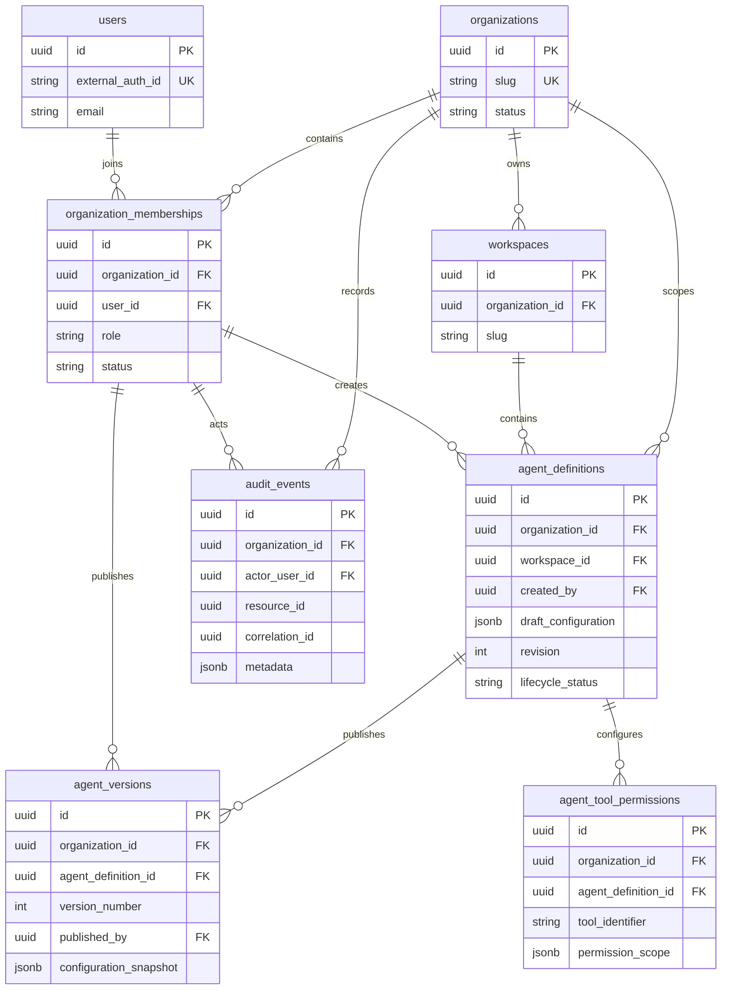

# Database relationships — Phase 2B

The diagram is Mermaid source. Relationships are implemented by named PostgreSQL foreign keys; rendering is not claimed as an automated test.

## Composite consistency rules

| Child key | Referenced unique key | Prevented inconsistency |
|---|---|---|
| agents(organization_id, workspace_id) | workspaces(organization_id, id) | Agent owned by A referencing B's workspace |
| agents(organization_id, created_by) | memberships(organization_id, user_id) | Creator who is not a member of the owning organization |
| versions(organization_id, agent_definition_id) | agents(organization_id, id) | A's version referencing B's definition |
| versions(organization_id, published_by) | memberships(organization_id, user_id) | Publisher with no membership in that organization |
| tool permissions(organization_id, agent_definition_id) | agents(organization_id, id) | Foreign-organization tool grant |
| audit(organization_id, actor_user_id) | memberships(organization_id, user_id) | Audit actor unrelated to the owning organization |

Composite membership FKs establish association, not active membership or authorization; active membership/roles require trusted service checks. Versions inherit workspace through their immutable definition reference; duplicate workspace_id is not stored on versions. Definitions cannot move organizations/workspaces, so prior version scope cannot silently change.

Audit resource_id is a polymorphic UUID rather than an FK to every possible resource type; consistency with resource_type is an application responsibility. correlation_id is an opaque UUID, not an identity credential. ORM view-only relationships allow traversal without silently assigning ownership through relationship writes. All deletion FKs are RESTRICT, preserving historical references.

See [full table and index specification](DATABASE_SCHEMA.md).

Checkpoint 2C retains these foreign-key relationships. A verified Clerk subject maps to one local user through unique external_auth_id; active local organization memberships, rather than provider organization claims, authorize traversal to tenant-owned records. Organization bootstrap creates an OWNER membership and a default workspace atomically. See [authorization](AUTHORIZATION.md).
