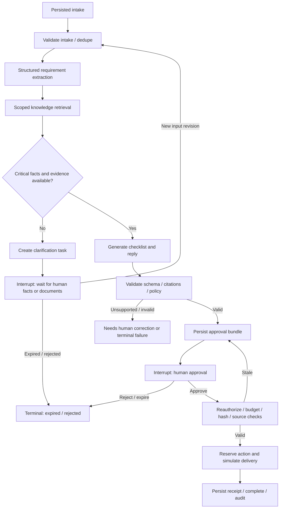

# Agent orchestration

Status: design, not an implemented graph. This is a bounded domain workflow with structured inference steps, not an open-ended autonomous agent loop.

## Smallest end-to-end workflow

A seeded workspace, one published onboarding specialist, one versioned workflow, one pre-ingested synthetic knowledge document, and one authenticated request produce a sourced checklist and draft. An eligible reviewer approves the exact bundle; the simulation adapter records one simulated delivery. The same request key yields the same run and action. This is the first implementation slice; full teammate editing, PDF ingestion, live models, and production connectors follow.



## Typed state contract

State is a schema-versioned JSON-serializable object validated with Pydantic at boundaries. It contains IDs/references and bounded structured values, never credentials or arbitrary executable code.

| Field group | Required values |
|---|---|
| Identity | schema_version, organization_id, workspace_id, run_id, thread_id, workflow_version_id, agent_version_ids, executor_version |
| Input | input_artifact_revision_id, input_revision, normalized customer reference, approved execution_mode |
| Requirements | typed requirements with stable IDs, priority, extracted source paths, missing required fields; bounded lists |
| Knowledge | authorized chunk IDs, immutable content hashes/locators, retrieval configuration/profile revision; no full raw corpus |
| Outputs | plan/draft artifact revision IDs, evidence links per item, bundle hash, recipient hash, validation findings |
| Control | graph status, next node, task/approval IDs, policy snapshot revision, node visit count, inference/repair/retry counters, active runtime consumed, wall-clock expires_at |
| Accounting | run cost limit, reservation/usage references, settled cost, estimated remaining worst-case cost |
| Recovery | durable node operation IDs, checkpoint ID, fence, safe error code, retry_after; fence is reloaded from DB, not trusted from serialized state |

Model result schemas: `RequirementsExtraction{requirements, missing_fields, classification}` and `OnboardingDraft{checklist[{item_id, text, evidence_chunk_ids}], questions, subject, body, risk_flags}`. Additional fields rejected; sizes bounded; model never chooses tool permission, recipient, tenant, approval result, or delivery mode. Recipient derives from validated intake and reviewer-approved action data. Evidence validator checks chunk membership/hash and source availability; semantic entailment needs evaluation/human review beyond ID matching.

## State transitions

Run statuses: `queued → running → awaiting_input | awaiting_approval | retry_wait | completed | failed | budget_exceeded | cancelled`. Waiting/retry states may return to queued through a persisted wake-up event. Waiting can become expired/rejected/cancelled. Terminal states cannot resume; an intentional rerun is a new run with a new key and linked provenance. A current run edits its artifacts through new revisions, never mutating the approved revision.

Steps: pending→running→succeeded/failed/unknown; retries create separate attempt rows. Approval: pending→approved/rejected/expired/invalidated; an approved decision becomes consumed with its action reservation or invalidated before consumption. Action: reserved→simulated for fixture mode; future live mode reserved→dispatching→succeeded/failed/unknown, with unknown requiring reconciliation. UI never labels simulated delivery as sent.

## Durable execution and crash recovery

1. Intake commits run, input, idempotency record, audit and outbox together. Relay publishes run ID only; untrusted queue fields cannot override tenant/run configuration.
2. Worker resolves the persisted scoped run, obtains thread ownership lock and DB lease/fence, loads exact graph/model/policy revisions, and establishes transaction-local scope for each repository and checkpointer connection.
3. Each node derives an operation key from run, stable node key, input revision and semantic operation hash. If completed output exists, return it without repeating deterministic effects or inference. If unresolved, reserve budget and record attempt before calling provider.
4. Node result, artifacts, usage settlement and audit commit atomically in domain tables, then graph checkpoint advances. A crash between those commits replays the node and reads its completed operation result. No distributed atomicity is assumed.
5. A crash after remote model success but before result persistence may repeat inference, with retained usage reservation and bounded extra cost. Exactly-once inference/billing is not claimed. Non-idempotent tool calls use BusinessAction, not plain node replay.
6. Every 15 seconds, a recovery scanner checks expired leases and pending outbox/operations. After lease expiry, a new worker obtains the same thread lock, increments the fence, and resumes from the persisted checkpoint or reconstructs initial state if none exists. It never initializes a new thread to “retry.” A live thread lock blocks takeover until released; alert on lock/lease inconsistency.
7. All domain/checkpoint writes are guarded by current run ownership. Loss of the dedicated DB lock session cancels execution; stale worker results are rejected. Verify the checkpoint adapter's fence behavior against the actual pinned package before accepting this design. A UUID thread ID or schema name alone is not authorization.
8. Reconciler compares terminal checkpoints and domain operation records, projects missing run/step status, and ensures waiting runs have task/approval records. Domain artifacts/actions remain authoritative for observable business effects. Impossible divergence enters manual recovery, never guessed delivery.

Checkpoint adapter requirements: use official Postgres saver behind a restricted wrapper; all read/write/list/delete calls resolve RunCheckpointBinding and verified scope. RLS must cover every checkpoint/write/blob table through that binding; bootstrap/install uses a privileged migration role only. No API exposes saver methods, thread listing, rewind, or arbitrary resume. Set strict serializer allowlists appropriate to selected package; never accept pickle or client-provided serialized state. Serialize invocations per thread and test stale-fence writes. If official schema cannot safely support these constraints, stop the slice until an isolated schema/role or reviewed adapter solution passes AC-02/03; do not silently fall back to memory.

## Approval protocol

An interrupt is a pause mechanism, not an authorization control. The graph prepares a durable approval row before interrupt using an idempotent insert; nodes may restart from their beginning on resume, so no unguarded side effects precede interrupt. Resume payload is a server-generated approval ID/decision revision, not a client Boolean.

```mermaid
sequenceDiagram
  participant O as Operator
  participant API as FastAPI
  participant DB as PostgreSQL
  participant W as Worker / LangGraph
  participant H as Human reviewer
  participant S as Simulation adapter
  O->>API: Intake + idempotency key
  API->>DB: Transaction: input/run/audit/outbox/key
  DB-->>API: Commit
  API-->>O: 202 + run ID
  W->>DB: Claim run / fence / load scope
  W->>DB: Persist node output + sourced draft
  W->>DB: Persist approval row (idempotent)
  W->>DB: Persist interrupt checkpoint
  H->>API: Decide on bundle hash + expected revision
  API->>DB: Lock/recheck role, hash, expiry; decision + audit + outbox
  DB-->>API: Commit approved decision
  W->>DB: Resolve approval; resume same thread
  W->>DB: Lock and recheck; consume approval / reserve unique action
  W->>S: Execute deterministic local simulation
  S->>DB: Persist one simulation receipt and audit
  W->>DB: Checkpoint and mark completed
```

Reviewer needs active membership, workspace reviewer grant, and capability for communication approval. Default requester cannot approve own request. Hash covers canonical exact plan/draft revision, recipient/channel, attachment hashes, connection revision, workflow version, mode and action kind. Role/policy/source changes are rechecked at dispatch and may invalidate approval. Expiry default 7 days. Rejection is terminal for that review; revision/resubmission creates a new bundle and approval. Edited recipients require new approval. Future live approval must never inherit a simulation-mode decision.

## Idempotency and side effects

Intake key scope is organization/workspace/operation; payload hash mismatch returns 409. Action key derives from run ID + stable delivery slot; payload hash is stored separately so a revised payload cannot silently use the same action slot. Run lock serializes approval, cancellation and dispatch. Unique action and approval consumption constraints enforce one recorded business action even across duplicate resumes. Simulation receipt and ledger finalization occur in one local transaction; a crash before commit can retry safely.

For a future live connector, commit reservation before network I/O and send the stable key to a provider with documented replay semantics. Crash after send/before receipt persistence becomes unknown. Query provider using the same key or reconcile manually; do not send using a new key. If provider offers neither idempotency nor lookup, that connector is outside automatic retry support. Human approval does not justify duplicate sending.

## Bounds, retry and budget policy

Default limits are [product targets](PRODUCT_REQUIREMENTS.md): 20 node visits, 5 active minutes, four inference calls including one repair, 30-second call timeout, three attempts on transient read/provider errors, 7-day human wait. Counters and active time accumulate across worker restarts and input revisions, not reset on resume. Clarification loops stop at bounds and request a new run. Exponential backoff with jitter (1/2/4 seconds capped by deadline); rate-limit retry respects Retry-After. Do not retry invalid credentials, authorization denials, schema failure beyond one repair, missing documents, or unsupported evidence as transient failures.

Reserve input + maximum output cost (and embedding cost where applicable) using immutable price snapshot and a safety margin before each inference attempt. Organization daily cap, workspace cap and run cap all apply; platform limits cap model rate/concurrency too. Unknown provider costs keep conservative reservations. Stop before a call that would exceed any cap; record budget_exceeded and expose remaining human options. A configurable pilot default is USD 1/run and USD 25/organization/day, proposal only. Reservations settle idempotently from provider usage; alerts catch price drift and unsettled reservations. A hard cap on provider invoices requires provider-side enforcement as well.

## Failure behavior

| Failure | Required behavior |
|---|---|
| Empty/revoked knowledge | Pause for approved documents; no evidence-free external-ready plan |
| Incomplete intake | Typed task with missing fields; no invented values |
| Malformed model output | One bounded repair under budget, then review/fail with safe diagnostics |
| Provider/read tool failure | Bounded retries; progress and safe error shown; no credentials in errors |
| Duplicate input/decision/queue item | Reuse run/decision/action or return conflict; never a second action |
| Worker/Redis loss | Reclaim persisted work from same checkpoint/operation ledger |
| Reviewer deactivated or bundle changed | Deny or invalidate; obtain fresh eligible review |
| Cancellation during call | Mark cancellation; reject late output/action unless already committed; report in-flight ambiguity |
| Checkpoint unavailable/corrupt | Stop safely, alert and recover/restore; never create a substitute run silently |
| External outcome unknown | Freeze action, expose reconciliation task; no blind retry |

References: [interrupt behavior](https://docs.langchain.com/oss/python/langgraph/interrupts) and [persistent thread state](https://docs.langchain.com/oss/python/langgraph/persistence). Atomic ledger, budgets and isolation controls above are application responsibilities, not framework guarantees.
