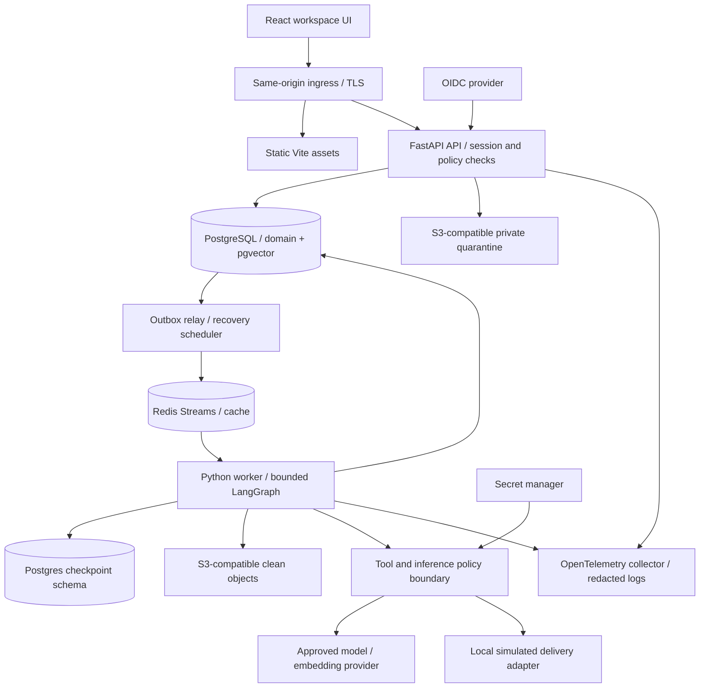

# Architecture

Status: proposed modular monolith, Phase 1 only. See [requirements](PRODUCT_REQUIREMENTS.md), [schema](DATABASE_SCHEMA.md), and [decisions](DECISIONS.md).

## System boundary

React/TypeScript/Vite uses Tailwind CSS and checked-in shadcn/ui components. A same-origin ingress serves static assets and routes `/api/v1` to Python FastAPI. React Flow shows the fixed workflow and run state. FastAPI, a Python worker, and an outbox/recovery process share domain modules and one release artifact; they are separate process roles, not microservices. Node.js is build tooling only.

Data paths crossing network boundaries require TLS, explicit credentials, timeouts, and allowlists. The model sees the minimum request and authorized chunks; it receives no DB access, secrets, or ability to approve actions.

## Modules and ownership

| Module | Responsibilities |
|---|---|
| identity/tenancy | OIDC sessions, organization provisioning, memberships, workspace grants |
| agents/workflows | Definitions, immutable versions, publish validation, capabilities |
| onboarding | Intake, tasks, artifact revisions, evidence, outcome |
| orchestration | Graph registry, state schema, checkpoint adapter, run/step lifecycle |
| knowledge | Quarantined upload, safe parsing, chunk/embedding lifecycle, retrieval |
| approvals/actions | Decision CAS, action ledger, outbox, simulation adapter |
| integrations | Connection metadata and secret handles; credential broker |
| budgets/evaluations | Spend reservation/settlement, case sets, offline quality runs |
| audit/observability | Transactional events, redaction, correlation, metrics |

FastAPI endpoints call domain services; SQLAlchemy repositories use a transaction-scoped tenant context; workers call the same services. Pydantic validates API and model payloads. Alembic owns domain migrations; checkpointer migrations are explicitly coordinated with release migrations. No API request executes a workflow synchronously.

## Persistence and delivery semantics

PostgreSQL is the durable source of truth for work, business actions, approvals, budgets, and audit. Redis Streams carry at-least-once wake-up hints; a DB scanner republishes undispatched work so losing Redis cannot lose accepted intake. A transactional outbox bridges DB commits and queue publication. Outbox duplicates are safe because workers claim DB leases and use durable operation keys.

Checkpoints and domain writes are NOT assumed to share a transaction. Each graph node uses durable operation records, keyed by run/node/input revision, before checkpointing; replay reuses completed output. A reconciler repairs domain projections from operation records/checkpoint state after a crash. See [orchestration](AGENT_ORCHESTRATION.md) for the recovery protocol and checkpoint isolation gate.

The guarantee is one recorded business action per scoped idempotency key. Exactly-once delivery to an arbitrary provider is not promised. A future connector must support provider idempotency or receipt lookup; ambiguous send outcomes stop for reconciliation, without blind resend.

## API contracts and UI

All workspace routes include `/organizations/{org_id}/workspaces/{workspace_id}`; URL values are selectors, never authorization evidence. Unsafe requests use CSRF protection and session authentication. Resource probes return 404 when the caller lacks scope; role denial on a visible resource returns 403. Bounded cursor pagination, schema-defined errors `{code, message, correlation_id, retryable}`, no stack traces.

| Route suffix | Contract |
|---|---|
| `POST /onboarding-requests` | Required Idempotency-Key; canonical payload hash; 202 with run/location, original response on replay, 409 on hash mismatch |
| `GET /runs`, `GET /runs/{id}`, `GET /runs/{id}/steps` | Scope checked; safe state, artifacts, evidence and metering |
| `GET /runs/{id}/events` | Authorized SSE with event cursor/reconnect; polling fallback; recheck session periodically |
| `POST /runs/{id}/cancel` | Compare-and-set; best-effort in-flight cancellation; no reversal of completed action |
| `POST /tasks/{id}/responses` | Expected revision, typed missing facts, idempotency key |
| `POST /approvals/{id}/decision` | Expected revision/hash, approve or reject, explanation; persists decision + resume outbox atomically |
| `POST /documents/uploads`, `POST /documents/{id}/complete` | Scoped signed upload, size/checksum confirmation, quarantine processing |
| `POST /agents`, `POST /agents/{id}/versions`, `POST /agents/{id}/publish` | Draft creation and immutable publication with capability validation |
| `GET /audit-events`, `GET /usage` | Role filtered views; never expose raw secrets/prompts |

Organization provisioning is a separate authenticated route that atomically creates organization, owner membership, workspace, and grant; does not require a preexisting tenant context. Membership/grant administration, workflow publication, document revocation/deletion, and integration metadata endpoints follow the same scoped policies; exact OpenAPI is a Phase 2 artifact.

UI surfaces: workspace switcher; onboarding intake; run list/detail with timeline and graph; evidence drawer with source location/status; teammate configuration/version history; approval inbox showing exact action; document ingestion; usage/audit views. Loading, empty, waiting, expired, denied, and recoverable error states must be explicit. Sanitized text/Markdown only; no raw HTML execution. Screen-reader labels, keyboard access, and visible simulated-delivery labels are required.

## Infrastructure and operations

Compose target: frontend build/ingress, API, worker, scheduler/relay, PostgreSQL with pgvector, Redis, S3-compatible local store, collector, and an explicit fixture OIDC service/profile. Development credentials stay in untracked env files; production uses workload identity and secret manager. DB is private, migrations use a separate owner role; runtime roles cannot migrate or bypass RLS. Liveness is process health; readiness checks required dependencies without exposing configuration.

OpenTelemetry traces correlate request/run/step/tool execution IDs; structured JSON logs carry tenant IDs and error codes without customer content. Metrics: queue age, lease expiry, run/step latency, approval age, retries, unknown action outcomes, budgets/reservations, retrieval failures, denied access, provider errors, outbox lag, checkpoint storage and reconciliation lag. Avoid tenant/run IDs as unbounded metric labels. Alert on stalled recovery, pending outbox growth, any unexplained action, and budget overshoot. Do not export prompts to an external tracing service by default.

Backups encrypt database and objects, use independent credentials and tested restores. Restore mode disables dispatch until action reconciliation and deletion tombstones are applied. Upgrade rollout drains workers and preserves graph-version executors for all live runs; incompatible checkpoints require a tested offline migration or explicit terminalization, never silent reinterpretation.

## Main tradeoffs

- Shared DB plus RLS simplifies operations but does not protect against a fully compromised application role setting arbitrary tenant context. Dedicated tenant databases are a later isolation tier.
- Redis hints plus DB outbox add reconciliation work but avoid coupling correctness to a volatile queue.
- Fixed graph and one specialist reduce scope; teammate collaboration and visual editing wait for measured need.
- Human gates slow throughput but bind accountable review to exact content.
- pgvector keeps transactions and filtering close; index tuning and embedding drift need measured corpus evaluation.
- Framework checkpoint schemas are outside our domain schema; a tenant-filtered checkpoint adapter is a release-blocking integration spike, not an assumed framework property.

## References checked on 2026-10-28

- [LangGraph persistence](https://docs.langchain.com/oss/python/langgraph/persistence): durable thread state; this design adds domain reconciliation.
- [LangGraph interrupts](https://docs.langchain.com/oss/python/langgraph/interrupts): checkpoint-backed pause/resume and replay constraints.
- [PostgreSQL row security](https://www.postgresql.org/docs/18/ddl-rowsecurity.html): default deny, owner bypass, FORCE RLS, role limits.
- [Postgres checkpointer reference](https://reference.langchain.com/python/langgraph.checkpoint.postgres): implementation integration and serializer hardening must be checked against the selected pin.
