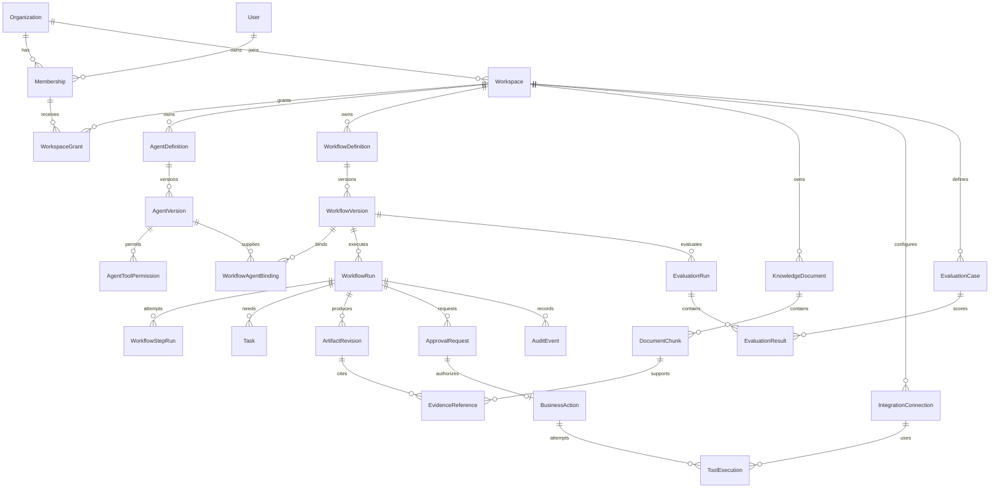

# Database schema design

Status: conceptual/logical specification; no migrations have been created. PostgreSQL with pgvector; SQLAlchemy models and Alembic migrations follow in Phase 2.

## Universal conventions and invariants

IDs are opaque application-generated UUIDs (UUIDv4 baseline); timestamps are UTC `timestamptz`. Mutable rows have `created_at`, `updated_at`, `row_version bigint` and compare-and-set updates. Published versions, artifacts, evidence, decisions, tool results, and audit records are append-only. Finite status fields use database CHECK constraints and Pydantic enums. Monetary values use integer USD micro-units with explicit currency/pricing version; token counts are nonnegative bigint. JSONB holds validated bounded configuration, not unindexed relational identity, secrets, or unconstrained chat logs.

Every tenant-owned table has `organization_id NOT NULL`; workspace-owned tables also have `workspace_id NOT NULL`. Each referenced tenant table has `UNIQUE(organization_id,id)`; each workspace table additionally has `UNIQUE(organization_id,workspace_id,id)`. All child foreign keys use the corresponding composite scope, preventing cross-tenant AND cross-workspace links even when IDs are valid. Workflow run versions, artifacts, tools, and documents must agree on workspace. Index foreign keys explicitly. Primary UUIDs remain globally unique; that does not replace composite scope constraints. Tenant-scoped unique constraints are never global unless intentionally described below.

RLS uses trusted transaction context with both USING and WITH CHECK. Workspace access additionally checks grants for user requests; worker roles have scoped service grants and no user-facing raw SQL access. Missing/invalid context denies access. Organization-wide tables have organization policies; user/session tables have self-only service access. See [security](SECURITY_MODEL.md). Tenant isolation is required on support tables and checkpointer storage, not just listed domain entities.

## Logical relationship diagram

Organization and Workspace ownership described below is inherited by child entities even where omitted from the diagram for readability. Diagram cardinalities do not imply cascade deletion.

## Required entities

Notation: `U(...)` is UNIQUE, `I(...)` an additional index. All foreign keys are scope-composite under the conventions above.

| Entity / ownership | Important fields and relationships | Constraints and indexes | Retention class |
|---|---|---|---|
| Organization / root tenant | id, display_name, slug, status, policy_revision, retention_policy, daily_cost_cap | U(slug); provisioning key scoped to authenticated user in intake ledger; status CHECK | T |
| User / global identity | id, oidc_issuer, oidc_subject, display_name, minimal email, disabled_at | U(oidc_issuer,oidc_subject); email is not an identity key | I |
| Membership / organization | id, user_id, role, status; FK User | U(org,user); I(user,status); active owner cannot be removed if last owner (serialized org lock) | I |
| Workspace / organization | id, name, slug, status, policy_revision | U(org,slug); I(org,status) | T |
| AgentDefinition / workspace | id, name, slug, description, archived_at, published_version_id | U(org,workspace,slug); published pointer must reference own version via composite key | C |
| AgentVersion / workspace | id, definition_id, version_number, instructions, model_profile_id, config_hash, knowledge_scope, budget_policy, created_by, published_at | U(org,workspace,definition,version_number); append-only after publish; I(definition,published_at) | C |
| AgentToolPermission / workspace | id, agent_version_id, tool_key, capability, validated resource constraints, risk_class | U(org,workspace,agent_version,tool_key,capability); immutable with version; intersect with runtime policy | C |
| WorkflowDefinition / workspace | id, name, slug, published_version_id, archived_at | U(org,workspace,slug); scoped own-version publication pointer | C |
| WorkflowVersion / workspace | id, definition_id, version_number, graph_key, executor_version, state_schema_version, config_hash, limits | U(org,workspace,definition,version_number); graph_key allowlisted; immutable published configuration | C |
| WorkflowRun / workspace | id, workflow_version_id, initiator_user_id, status, input_revision, thread_id, execution_mode, policy_snapshot_hash, deadline, lease_owner, lease_until, fencing_token, terminal_reason | U(org,workspace,thread_id); I(org,workspace,status,created_at,id); I(status,lease_until); immutable version/mode; status CAS | O |
| WorkflowStepRun / workspace | id, run_id, node_key, input_revision, attempt, status, operation_key, result_artifact_id, safe_error_code, started_at, ended_at, cost | U(org,workspace,run,node,input_revision,attempt); I(run,started_at); separate durable NodeOperation handles replay | O |
| Task / workspace | id, run_id, type, status, assignee_membership_id, requested_fields, response_artifact_id, input_revision, expires_at | I(org,workspace,status,assignee); U(run,type,input_revision) within scope; CAS response/expiry | O |
| ApprovalRequest / workspace | id, run_id, artifact_revision_id, action_hash, recipient_hash, policy_revision, status, requested_by, decided_by, decision_reason, decided_at, expires_at | U(org,workspace,run,action_hash); I(org,workspace,status,expires_at); one terminal decision by CAS; decision actor must be eligible | A |
| KnowledgeDocument / workspace | id, logical_document_id, revision, object_key, checksum_sha256, media_type, ingestion_status, parser_version, source_label, revoked_at | U(org,workspace,logical_document,revision); U(org,workspace,object_key); I(org,workspace,ingestion_status); immutable content revisions | K |
| DocumentChunk / workspace | id, document_id, ordinal, content_hash, text_object_ref or bounded text, page/section/offset, embedding, embedding_model_revision | U(org,workspace,document,ordinal,embedding_model_revision); I(org,workspace,document); tenant-filtered vector search, exact scan initially | K |
| IntegrationConnection / workspace | id, provider, display_name, status, secret_reference, credential_revision, allowed_resource_metadata | U(org,workspace,provider,display_name); I(org,workspace,status); opaque secret-manager handle only | C |
| ToolExecution / workspace | id, run_id, step_id, business_action_id nullable for read-only tools, connection_id nullable for fixture, tool_key, attempt, execution_mode, status, request_hash, result_ref, provider_receipt, safe_error, timestamps | U(org,workspace,business_action,attempt) for action attempts; I(run,created_at); I(status,updated_at); no raw credential fields | O/A |
| AuditEvent / organization, workspace optional for org actions | id, sequence, actor_type/id, event_type, resource_type/id, run_id nullable, before/after safe hashes, correlation_id, timestamp | U(org,sequence); I(org,workspace,timestamp,id); I(org,resource_type,resource_id); insert-only runtime permission | A |
| EvaluationCase / workspace | id, dataset_key, case_key, revision, fixture_input_ref, expected_assertions, rubric_version, data_classification | U(org,workspace,dataset_key,case_key,revision); immutable revisions; synthetic/deidentified data default | E |
| EvaluationRun / workspace | id, workflow_version_id, dataset_manifest_hash, model/pricing revisions, seed if supported, status, scorer_version, aggregate_metrics, initiated_by | I(org,workspace,created_at); all evaluation execution_mode=simulation | E |

Identity, audit actor, and organization provisioning paths need carefully restricted global FKs to User. Domain run creator uses scoped Membership where practical so membership history survives user deactivation. Deleting an identity pseudonymizes actor labels rather than breaking historical FKs.

## Supporting entities required for correctness

| Entity | Required shape and invariants |
|---|---|
| WorkspaceGrant | org/workspace/membership FK, role, status; U(org,workspace,membership); membership must belong to org. Organization owner/admin explicitly receives administrative workspace access by policy. |
| WorkflowAgentBinding | workflow_version_id, node_key, agent_version_id; U(scope,workflow_version,node_key); all in same workspace. |
| ArtifactRevision | run_id, kind, revision, schema_version, canonical content/hash, object_ref if large, created_by; U(scope,run,kind,revision); immutable; binds plan and draft to one review bundle hash. |
| EvidenceReference | artifact_revision_id, item_key, chunk_id, content_hash, source_locator, retrieval_score, retrieved_at; U(scope,artifact,item_key,chunk); cannot reference another workspace. |
| IntakeIdempotency | workspace, route_operation, key_hash, canonical_request_hash, response_code/body_ref, run_id, expires_at; U(org,workspace,route_operation,key_hash); concurrent insert determines winner; scope includes endpoint semantic operation. |
| BusinessAction | run_id, approval_id, kind, action_slot, execution_mode, payload_hash, idempotency_key_hash, status, receipt, fenced_revision; U(scope,kind,idempotency_key_hash); U(scope,run,action_slot); U(scope,approval_id); immutable payload; unknown outcome distinct from failure. |
| OutboxEvent | org/workspace, id, aggregate_id, event_kind, dedupe_key, payload_ref, available_at, published_at, attempt; U(scope,dedupe_key); partial I(available_at) WHERE published_at IS NULL. Claim with SKIP LOCKED. |
| NodeOperation | run_id, node_key, input_revision, semantic_operation_hash, status, output_ref, attempt, lease/fence, usage_reservation_id; U(scope,run,node,input_revision,semantic_operation_hash). Stores replay result before checkpoint; inference attempts may be uncertain after timeout. |
| BudgetAccount / BudgetReservation / UsageLedger | org account and workspace/run sublimits, UTC accounting day, policy_revision; lock shared account before reserve; unique operation reservation; ledger unique(provider_request_id,attempt scope). Unknown usage keeps reservation charged until reconciled. |
| ModelProfile | org/workspace, provider/model/embedding revision, maximum context/output, price_snapshot, approved_data_region, credential handle reference; immutable revision; no provider secret. |
| EvaluationResult | evaluation_run_id, evaluation_case_id, workflow_run_id, metrics, evaluator_revision; U(scope,evaluation_run,case); links actual simulation run and case snapshot. |
| Session | opaque session token digest, User FK, expiry, OIDC token secret-reference if needed; identity service only, no domain API table access. |
| RunCheckpointBinding | org/workspace/run/thread_id; unique thread and run; authoritative ownership for checkpointer adapter. Framework checkpoint tables live in restricted schema with RLS ownership via this binding, including blobs and writes. |
| DeletionTombstone | scoped entity/object/hash references, requested_at, applied_at, backup_expiry; minimal non-content metadata supports deletion after restore. |

## Retrieval and evidence design

For the first small corpus, exact pgvector distance search after SQL organization/workspace/document-status filtering is preferred to an approximate index. Embedding dimensions are fixed by a selected immutable model profile; changing dimensions requires a separate column/table generation and migration, not mixed vectors. Use B-tree scope/status indexes first; add HNSW only after recall/selectivity tests confirm authorized filtered retrieval meets the evidence benchmark. Never retrieve globally and filter in Python. Enforce source authorization again when viewing evidence and before approving/delivering. Revocation invalidates dependent pending approvals. Deleted/revoked content shows an unavailable-source marker; do not restore content from checkpoints to unauthorized users.

## Concurrency and transactional boundaries

- Publish: lock definition; allocate next version; validate tool/knowledge policy; commit immutable version, binding, pointer, and audit together.
- Intake: insert idempotency record, run, immutable input artifact, budget eligibility snapshot, audit, and outbox in one DB transaction. On unique conflict compare stored canonical hash; do not create another run. Normalize schema version, Unicode and optional defaults consistently; exclude transport metadata from hashing.
- Worker: claim eligible run using row lock and increment fencing token; heartbeat every 10 seconds, 45-second lease. All domain writes check current fence. Use a dedicated session advisory lock for the thread for the whole graph invocation; a worker losing its DB lock/connection must abort. Checkpointer write fencing and crash takeover are release-blocking spike requirements.
- Approval: lock run then approval; lock/check bundle revision and current eligibility; transition pending→approved/rejected once; atomically write audit and resume outbox. Dispatch locks run/action/approval in the same consistent order, rechecks policy, and consumes one approval to reserve one action. Cancellation and dispatch serialize; cancellation cannot revoke an already submitted provider action.
- Budget: fixed lock order organization→workspace→run account, reserve worst-case request cost before provider call; settle actual usage once. Never perform provider I/O inside long DB transactions.
- CHECK constraints enforce nonnegative limits and legal field combinations; domain transition functions and CAS enforce legal status edges. Deadlocks/serialization errors retry boundedly; uniqueness violations map to deterministic replay/conflict.

## Retention and deletion defaults (proposals, not legal advice)

| Class | Default and deletion behavior |
|---|---|
| T tenant/config root | Active subscription lifetime; close tenant disables dispatch immediately; purge after 30-day operator recovery window unless hold. |
| I identity | Active membership plus 30 days; minimize/pseudonymize identity once unneeded, retaining nonidentifying audit actor references. |
| C definitions/config | Referenced versions retained with associated runs/audits; unreferenced drafts purge after 90 days; no secrets in configuration. |
| O operational | Runs, steps, tasks, artifacts, checkpoints, node operations, tool payloads: 90 days after terminal state; paused work expires first. Usage totals without content may remain 13 months. |
| A action/audit | Decisions, action receipts, safe audit metadata: 365 days; action idempotency tombstones retained at least that long and never removed while replay/resume is possible. |
| K knowledge | Active revisions until superseded/revoked; purge source/chunks/embeddings 30 days after deletion request, earlier where contract requires; revoke access immediately. Evidence hashes/locators survive without source text where allowed. |
| E evaluations | Synthetic fixtures may be versioned indefinitely; tenant-derived fixtures/results 90 days unless explicit consent and policy. |

Intake idempotency replay window is at least 90 days and cannot expire while run is nonterminal; clients must not reuse keys. External action ledger window is 365 days minimum; after expiry old requests return 410 rather than create new work if a retained request tombstone matches. Define long-term tombstone contract before production (D-08). Purge in dependency order using bounded jobs, not uncontrolled ON DELETE CASCADE. Tenant closure covers database, objects, embeddings, Redis caches, checkpoints, telemetry, and provider retention obligations. Backups expire within proposed 35 days; restore applies deletion tombstones before enabling access. Legal holds override purge but never revive authorization. Exact contractual periods remain unresolved.
